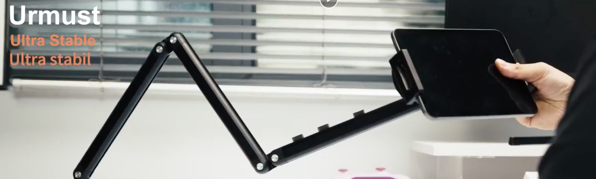

我晚间最爱的活动之一，是瘫在床上，举着 iPad 或手机看视频。可 iPad 实在太重了，举着的时候总担心它突然掉下来砸到脸；手机屏幕又太小，看久了总觉得不自在。

我想到的破局方案，是买一个小 Pad。这样既能舒舒服服地躺着刷，又不会有太大的重量负担。可很长一段时间里，iPad 产品线里只有 iPad mini 7，那个能“停航母”的大黑边实在让我难以接受。安卓和鸿蒙倒是有一些小平板，但总觉得和我现有的设备生态不太匹配，而且也是各有各的不足。前几天，iPad mini 8 终于发布了，可起售价直接来到了 5000 元人民币，又让我望而却步。

前天晚上，SMS 给我种草了 iPad 床头支架。我突然发现，只要花几十块钱，就能在床上自由享用 13 寸的大屏幕。于是我连夜激情下单，因为页面上显示周五就能送到。

下单的那一刻，我已经开始想象周五回家拆开快递，立刻把它固定到我的 IKEA 移动书桌上。这样只要把小桌板推到床边，就能把 iPad 架起来，彻底解放双手，舒舒服服地享受大屏幕。

**想象十分美好，结果快递延误了😅**

在 Amazon 或德国的独立站买东西，碰到快递延误几乎已经成了家常便饭。每次都像吃了苍蝇一样难受。邮件里写着 “We are sorry”，让我觉得又生气又好笑。实际上没人真的 sorry，最后只能自己吃哑巴亏。“It will be delivered tomorrow”？明天可是周日，派件老爷们可不上班。

能联系谁呢？负责派件的 DPD 吗，还是销售商 Amazon ？谁又会真正理你呢。最后只能自己憋一肚子气。DHL、UPS，几乎所有在德国做民用配送的快递都差不多。或许商用物流会更注重时效，但在德国生活过的人，大概多少都经历过快递员为了省事延误派件、不上门而直接把包裹扔到几公里外某个陌生的取件点，甚至干脆把包裹弄丢。真到要处理问题时，又得和机器人聊天，重复听车轱辘话，发邮件更不知道得多久才能收到回复。

反而是 Joybuy 京东让我看到了一点希望：原来在德国，物流也是可以好好派件的。三十年河东，三十年河西。如今杀到欧洲的 Joybuy，已经在亚超和电商平台领域起到了一定的鲶鱼效应。至于物流领域，虽然目前我还没有感受到类似的变化，但或许也不远了。未来已来。